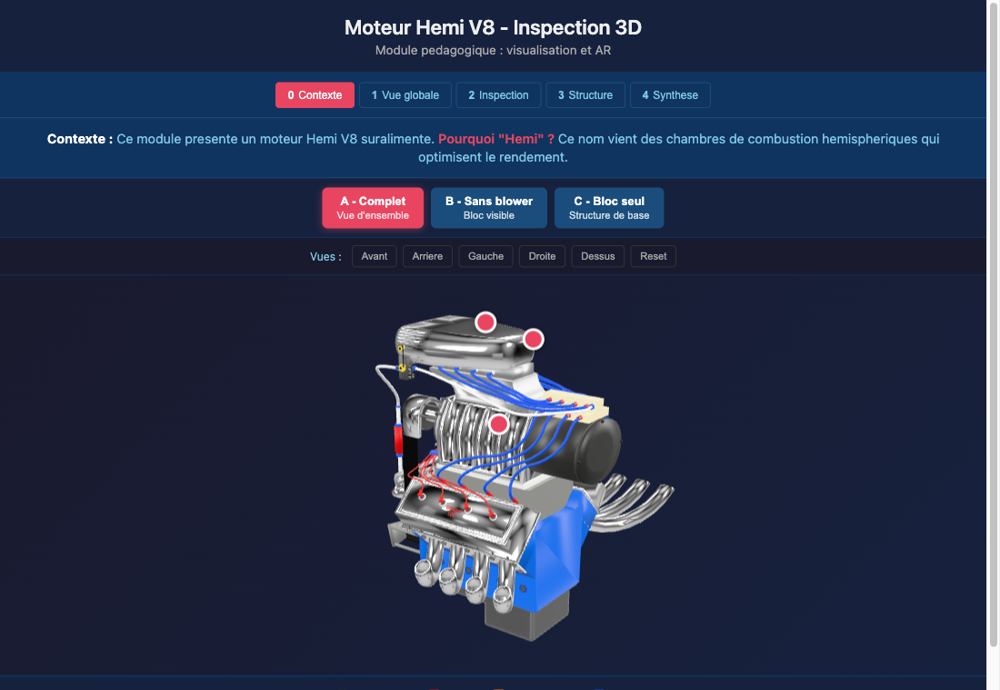

# Hemi V8 — 3D & AR inspection module

**A browser-based training module to explore a supercharged Hemi V8 engine in 3D and in augmented reality**, before touching the real one in the workshop. No install, no app: open the link on a phone and place the engine on your desk.

**[▶ Live demo](https://fredbourouliou.github.io/hemi-engine-ar/)** · UI in French

<p align="center">
  
</p>

## What it does

- **5 guided phases** — context, overview, inspection, structure, synthesis — each with its own instruction banner.
- **3 engine states**, one GLB each: full engine, without the blower, bare block. Switching states shows what each disassembly step reveals.
- **Hotspots, camera presets** (front, back, left, right, top) and a colour legend of the sub-assemblies.
- **AR on mobile** via iOS Quick Look and Android Scene Viewer: real-scale placement, walk around the engine.

AR mode is deliberately limited to placement: hotspots and state changes stay in the 3D view. The [A-Frame variant](https://github.com/FredBourouliou/a-frame-hemi-engine) keeps them interactive in AR, at the cost of a printed marker.

## How it's built

- [`<model-viewer>`](https://modelviewer.dev/) + vanilla HTML/CSS/JS — no framework, no build step.
- The Blender file is the single source of truth: [`scripts/export_states.py`](scripts/export_states.py) exports the three states as separate GLB files in one headless run.

```bash
blender hemi_engine.blend --background --python scripts/export_states.py
python3 -m http.server 8000   # then open http://localhost:8000
```

## Related

- [exploration-3d-moteur](https://github.com/FredBourouliou/exploration-3d-moteur) — the same engine as a step-by-step procedure (exploded view, isolation) · [demo](https://fredbourouliou.github.io/exploration-3d-moteur/)
- [a-frame-hemi-engine](https://github.com/FredBourouliou/a-frame-hemi-engine) — A-Frame + AR.js version with interactive hotspots in AR · [demo](https://fredbourouliou.github.io/a-frame-hemi-engine/)

Teaching notes (French): [docs/integration-pedagogique.md](docs/integration-pedagogique.md).

## License

Code (HTML, CSS, JS, Python export scripts) under the [MIT License](LICENSE).
